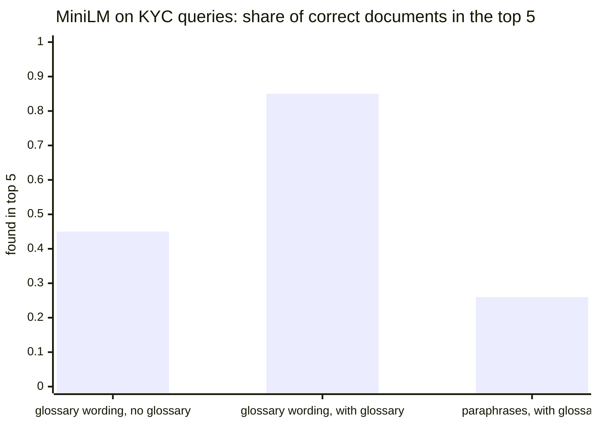
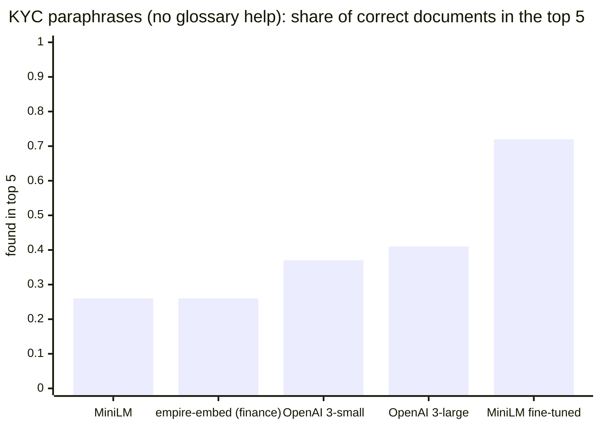

# Nevis Search API

Search API for a wealth-management firm: one `GET /search` across clients and their documents.
Clients are found by email, name or description, including partial words and typos
(`NevisWealth` -> `john.doe@neviswealth.com`); documents are found by meaning, with a
Sentence-BERT model fine-tuned on wealth-management text and a domain synonym glossary
(`address proof` -> a utility bill), plus exact terms such as an IBAN.

- **Live:** https://neviswealthhometask.online (Swagger UI at
  [`/docs`](https://neviswealthhometask.online/docs)); every endpoint except `/health` and the
  docs needs the `X-API-Key` header, the key is shared separately.
- **Stack:** Python 3.14, FastAPI, PostgreSQL 18 with pgvector and pg_trgm, SQLAlchemy +
  Alembic, Docker Compose, Traefik (HTTPS), GitHub Actions (tests, build, deploy).

## Quick start

```bash
cp .env.example .env
docker compose up --build
```

- API: http://localhost:8000
- Swagger UI: http://localhost:8000/docs

Set `OPENAI_API_KEY` in `.env` to get document summaries: without it the `worker` service exits
and requested summaries stay `pending`. Everything else works without it.

## API examples

The examples use data from the live deployment. Locally, use
`http://localhost:8000` and leave the key out if `API_KEY` is empty.

```bash
API=https://neviswealthhometask.online
KEY=<your API key>
```

### Create a client

```bash
curl -X POST "$API/clients" -H "X-API-Key: $KEY" -H "Content-Type: application/json" -d '{
  "first_name": "John",
  "last_name": "Doe",
  "email": "john.doe@neviswealth.com",
  "description": "Retired engineer focused on capital preservation"
}'
```

`201 Created`:

```json
{
  "id": "01a1cec7-c6c4-73e6-b609-ea784ee01037",
  "first_name": "John",
  "last_name": "Doe",
  "email": "john.doe@neviswealth.com",
  "description": "Retired engineer focused on capital preservation",
  "social_links": [],
  "created_at": "2026-11-12T08:02:41.476212Z"
}
```

The same email again, in any letter case: `409 Conflict`,
`{"detail": "A client with email 'JOHN.DOE@neviswealth.com' already exists"}`.

### Add a document to a client

```bash
curl -X POST "$API/clients/01a1cec7-c6c4-73e6-b609-ea784ee01037/documents" \
  -H "X-API-Key: $KEY" -H "Content-Type: application/json" -d '{
  "title": "Utility bill",
  "content": "Electricity and gas charges for 14 Elm Grove, Manchester. Amount due 182.40 GBP."
}'
```

`201 Created`:

```json
{
  "id": "01a1cec7-c7ac-7709-a649-674dc4d45596",
  "client_id": "01a1cec7-c6c4-73e6-b609-ea784ee01037",
  "title": "Utility bill",
  "content": "Electricity and gas charges for 14 Elm Grove, Manchester. Amount due 182.40 GBP.",
  "created_at": "2026-11-12T08:02:41.708880Z",
  "summary_status": "not_requested",
  "summary": null
}
```

Unknown client: `404`. The same content again for this client (even under another title): `409`
with the id of the document that already has it. Content over 100,000 characters: `422`.

### Search

One list of clients and documents, best match first. `type` tells them apart, `matched_by`
says which retrievers found the item, `score` is the fused rank score (higher is better).

**A company name finds the client by email domain:**

```bash
curl -G "$API/search" -H "X-API-Key: $KEY" --data-urlencode "q=NevisWealth"
```

```json
[
  {
    "type": "client",
    "score": 0.01639344262295082,
    "matched_by": ["lexical"],
    "client": {
      "id": "01a1cec7-c6c4-73e6-b609-ea784ee01037",
      "first_name": "John",
      "last_name": "Doe",
      "email": "john.doe@neviswealth.com",
      "description": "Retired engineer focused on capital preservation",
      "social_links": [],
      "created_at": "2026-11-12T08:02:41.476212Z"
    }
  }
]
```

A typo works too: `q=neviswelth` returns the same client.

**A concept finds documents that never use its words:**

```bash
curl -G "$API/search" -H "X-API-Key: $KEY" --data-urlencode "q=address proof"
```

```json
[
  {
    "type": "document",
    "score": 0.01639344262295082,
    "matched_by": ["semantic"],
    "document": {
      "id": "01a1cec7-c7ac-7709-a649-674dc4d45596",
      "client_id": "01a1cec7-c6c4-73e6-b609-ea784ee01037",
      "title": "Utility bill",
      "created_at": "2026-11-12T08:02:41.708880Z",
      "summary_status": "ready",
      "summary": "The document is a utility bill for electricity and gas charges at 14 Elm Grove, Manchester. It concerns the resident or account holder of this address. The total amount due is £182.40."
    },
    "snippet": "Electricity and gas charges for 14 Elm Grove, Manchester. Amount due 182.40 GBP."
  },
  {
    "type": "document",
    "score": 0.016129032258064516,
    "matched_by": ["semantic"],
    "document": {
      "id": "01a1d0c7-1436-761c-be99-a70ebac5c638",
      "client_id": "01a1d0c7-10ec-743a-9444-61124cc523b2",
      "title": "Council tax bill 2026",
      "created_at": "2026-11-12T17:21:10.198164Z",
      "summary_status": "ready",
      "summary": "This document is a council tax bill for the year 2026 from Zurich municipality. It concerns Anna Schmidt for the residence at Seestrasse 12, 8002 Zurich. The amount due is CHF 1,240, payable by 30 April 2026."
    },
    "snippet": "Zurich municipality council tax statement for the residence at Seestrasse 12, 8002 Zurich, addressed to Anna Schmidt. Amount due CHF 1,240 by 30 April 2026."
  }
]
```

**An exact identifier is found by full-text search:** `q=CH93 0076 2011 6238 5295 7` returns
the "Share purchase agreement" that contains this IBAN, with `"matched_by": ["full_text"]`.

**Nothing relevant returns an empty list:** `q=weather forecast` -> `[]`.

**Search one client's documents** with `client_id`. Only that client's documents are returned
(no client hits); an unknown `client_id` gives `404`:

```bash
curl -G "$API/search" -H "X-API-Key: $KEY" --data-urlencode "q=address proof" \
  --data-urlencode "client_id=01a1cec7-c6c4-73e6-b609-ea784ee01037"
```

This returns only John Doe's "Utility bill" from the example above, without Anna Schmidt's
"Council tax bill".

### Summarise a document

Summaries are made on request. Ask for one, then poll until it is `ready` (usually a few
seconds) or `failed`:

```bash
curl -X POST "$API/documents/01a1d0d7-1563-77ca-8744-ceac9c5cee88/summary" -H "X-API-Key: $KEY"
```

`202 Accepted`:

```json
{"document_id": "01a1d0d7-1563-77ca-8744-ceac9c5cee88", "status": "pending", "summary": null, "error": null}
```

```bash
curl "$API/documents/01a1d0d7-1563-77ca-8744-ceac9c5cee88/summary" -H "X-API-Key: $KEY"
```

`200 OK`, a few seconds later:

```json
{
  "document_id": "01a1d0d7-1563-77ca-8744-ceac9c5cee88",
  "status": "ready",
  "summary": "This document is the annual pension statement from the Swiss Life occupational pension fund for Anna Schmidt, reference number 1794505118. It reports her current retirement savings of CHF 412,300 and a projected annual pension of CHF 27,800 starting at age 65.",
  "error": null
}
```

Requesting a ready summary again returns it with `200` and makes no new LLM call; requesting a
`failed` one tries again.

### Errors

| status | when | body |
|---|---|---|
| `401` | missing or wrong `X-API-Key` | `{"detail": "Invalid or missing API key"}` |
| `404` | unknown client or document id | `{"detail": "Client '...' not found"}` |
| `409` | email already used, or the same document already uploaded for the client | `{"detail": "..."}` |
| `422` | invalid input: bad email, blank or too long query, document over 100,000 characters | `{"detail": ...}` |

## How search works

`GET /search?q=...` returns one list of clients and documents ranked by relevance. Four
retrievers run independently and are merged with Reciprocal Rank Fusion (RRF, `k = 60`), which
combines ranks instead of raw scores, so trigram similarity, cosine similarity and full-text rank
never have to be compared directly:

| retriever | what it catches | example |
|---|---|---|
| clients: substring + trigram (`pg_trgm`) on email, full name, description | names, email domains, typos | `NevisWealth` -> `john.doe@neviswealth.com`, `neviswelth` |
| clients: Sentence-BERT on description | meaning of the description | |
| documents: Sentence-BERT on chunks | meaning, paraphrases | `investment strategy` -> "Portfolio review" |
| documents: Postgres full-text on chunks | exact terms embeddings miss | an IBAN or account number |

Before that, the query is expanded with domain synonyms from the `search_synonyms` table
(see below). Semantic matches below a cosine similarity of `0.27` are dropped, so an unrelated
query such as `weather forecast` returns an empty list instead of "the least bad" documents.

**Known limitation: long documents can crowd out others.** Document search fetches the 100
best-matching chunks (5 per result) and keeps the best chunk of each document. A long document
can have up to ~120 chunks; if one long report fills all 100 slots, other relevant documents
are not returned. Not fixed yet: it can be solved by fetching more chunks until enough
different documents are found.

## Search quality: the embedding trade-off

The assignment's example, `address proof` -> a document containing `utility bill`, needs domain
knowledge: in KYC a utility bill *is* a proof of address, but the two phrases share no words and
a general-purpose model does not know they mean the same thing. Getting this right took several
attempts.

### How I measured

The test set was generated with an AI assistant (an LLM): a small set of the kind of content a
wealth advisor searches, 42 documents (KYC, income and source of funds, tax, investments,
pensions, estate planning, insurance, plus a few unrelated ones), written the way real documents
read, so a utility bill never says "proof of address". For 44 queries it lists which documents
are the correct answers. The queries come in four groups:

- **Glossary wording** (7 queries): KYC concepts phrased the way the synonym glossary phrases
  them, e.g. `address proof`, `photo id`.
- **Paraphrases** (8 queries): the *same* KYC concepts in other words, e.g. `evidence of
  residence`, `where does the client's money come from`. The glossary cannot help here, so this
  group shows whether the model itself understands the concept. It keeps the test honest: the
  first group uses the glossary's own wording, so it flatters the glossary.
- **General finance** (23 queries): topics the glossary does not cover, e.g. `pension`,
  `estate planning`.
- **Short** (6 queries): one or two words, e.g. `address`, `residence`, `earnings`.

Plus 5 "noise" queries (e.g. `weather forecast`) that should return nothing.

Two numbers are reported, both from 0 to 1, higher is better:

- **Found in top 5**: of the correct documents for a query, what share appears among the first 5
  results; averaged over the queries of a group. 0.85 means that, typically, 85% of what the
  advisor is looking for is on the first screen.
- **Filter quality (F1)**: the API does not just rank, it also drops results below a similarity
  threshold, so that `weather forecast` returns an empty list. F1 measures how well one threshold
  separates correct results from wrong ones across all queries, noise included: it is high only
  if few wrong results get through *and* few correct ones get cut. The threshold that gives the
  best F1 is the one the API should use.

(I also computed two more ranking measures, MRR, "how high is the first correct result", and
nDCG, "how good is the order of the top 10". They tell the same story as "found in top 5", so they
are left out here.)

### Step 1: the plain Sentence-BERT model

I started with `sentence-transformers/all-MiniLM-L6-v2`: small (~90 MB), fast on the 2-vCPU,
CPU-only server, and a common default. On general finance it is good (0.92 found in top 5), but on
KYC concepts it is weak: 0.45 with the glossary wording and 0.26 on paraphrases, i.e. most of the
KYC documents an advisor asks for are not on the first screen.

### Step 2: a synonym glossary

A quick, explainable fix: a table of domain synonyms (`address proof` -> `utility bill`, `bank
statement`, ...). When a query contains a glossary term, the search also looks for its synonyms.
This lifts the glossary-wording group from 0.45 to 0.85 and does not change anything else.

But it only fires on the exact wording it contains: on paraphrases it does nothing (0.26 stays
0.26). An advisor typing `evidence of residence` instead of `proof of residence` gets no help.



### Step 3: a better ready-made model that fits the server

The server has 2 vCPUs, 3.8 GB RAM and no GPU, so the model has to be small. I looked for models
trained on financial text and tried, among others, `WealthFromAI/empire-embed` and
`philschmid/bge-base-financial-matryoshka`, as well as larger general models (`all-mpnet-base-v2`,
`bge`, `e5`, `gte`) and more finance models (`fin-mpnet-base`,
`finance-embeddings-investopedia`, `snowflake-arctic-embed-financial`, `modernbert-embed-finance`,
`finance-gemma-300m-emb`, ...). Some are slightly better on general finance (`empire-embed`: 0.95),
but none understands the KYC paraphrases any better than MiniLM (0.25-0.26), several are worse, and
the strongest need more RAM or a GPU than the server has. I found no public KYC/AML-specific
embedding model.

### Step 4: OpenAI embeddings

Next I tried a large hosted model, OpenAI `text-embedding-3-small` and `text-embedding-3-large`.
`3-large` is the best model on general finance (0.99) and the best ready-made model on paraphrases,
but still weak there (0.41). Its filter quality is not better (F1 0.61 with the glossary vs 0.63
for MiniLM), and it adds per-query latency, cost and an external dependency that sees client data.
Not worth it for this use case.

### Step 5: fine-tuning MiniLM on wealth-management data

Since no ready model knows KYC, I taught one: I fine-tuned `all-MiniLM-L6-v2` on synthetic
wealth-management documents and advisor-style queries (details in
[The fine-tuned model](#the-fine-tuned-model)). Same size and speed as the original, so it still
runs on the server.

The training data has to teach the concept, not a word. Generated documents read like real ones
and never name what they are used for: the words "address", "identity", "income", "wealth" and
"residence" are banned from document text, and details are written inline ("Supply at 14
Rosewood Drive") rather than as labelled fields ("Billing address: ..."). Otherwise the model
learns that the query word "address" matches documents containing "address", and a real bill
without that word is not found. Every document also gets one- or two-word queries (`address`,
`earnings`), since advisors type those too.

Paraphrases go from 0.26 to 0.72, well ahead of OpenAI `3-large` (0.41); general finance improves
too (0.92 -> 0.97), so nothing was forgotten. It is also much better at putting the right document
first: for paraphrases the first correct result is on average at position ~1 (MRR 0.94, vs 0.43
for the original). Together with the glossary it has the best filter quality of all setups
(F1 0.66). Three training runs with different random seeds gave the same picture. Its
similarities are lower overall and short queries score lowest, so the API keeps results above
0.27, the F1-optimal threshold with the glossary. **This is what the API uses.**



### Step 6: OpenAI file search, the managed alternative

OpenAI also sells search as a service: upload files to a
[vector store](https://developers.openai.com/api/docs/guides/retrieval), and it splits them into
chunks, embeds them, and searches them by meaning and by words at once, optionally rewriting the
query with an LLM first (`rewrite_query`). It is the same design as this API (hybrid search,
results merged by rank, a score threshold, filtering by attributes such as a client id), fully
managed. I uploaded the 42 test documents to a vector store and ran the same queries:

| engine | glossary wording | paraphrases | general finance | short | filter quality (F1) @ threshold |
|---|---|---|---|---|---|
| **ours: MiniLM fine-tuned + glossary** | **0.82** / MRR **1.00** | **0.72** / MRR **0.94** | 0.97 / MRR **1.00** | 0.79 / MRR **1.00** | **0.66** @ 0.27 |
| OpenAI file search | 0.50 / MRR 0.58 | 0.57 / MRR 0.62 | **0.99** / MRR 0.93 | **0.85** / MRR 0.83 | 0.50 @ 0.46 |
| OpenAI file search + `rewrite_query` | 0.48 / MRR 0.55 | 0.66 / MRR 0.75 | **0.99** / MRR 0.93 | **0.85** / MRR 0.83 | 0.52 @ 0.47 |

OpenAI is better on general finance and on one-word queries, where matching the words helps. It is
clearly worse on KYC concepts, the domain knowledge this assignment is about: for `address proof`
its best result is the certificate of *tax* residence. Its scores also separate right from wrong
results less well (F1 0.50-0.52 vs 0.66). On top of that it sends every document and query to a
third party, adds a network round trip per search, and costs money per search and per stored GB.
So I did not add it to the API; it is a reasonable option for a team that wants no search
infrastructure of its own and has no KYC-specific vocabulary.

### What the search finds: examples

A few of the 42 test documents (title and text, as they are stored):

| document | text |
|---|---|
| British Gas bill | Electricity and gas charges for 1 Jan - 31 Mar 2026. Account holder Sarah Mitchell, 14 Elm Grove, Manchester M14 6PQ. Amount due 182.40 GBP. |
| Thames Water invoice | Water and sewerage charges for 2026/27 for the property at 3 Riverside Walk, Reading RG1 8DB. Customer: Tom Baker. |
| Council tax bill 2026/27 | Manchester City Council. Band C property at 14 Elm Grove. Annual charge 1,812 GBP payable in 10 instalments. |
| Payslip March 2026 | Gross salary 7,500 GBP, income tax 1,620, National Insurance 410, net pay 5,470. Employer: Acme Ltd. |
| Workplace pension annual statement | Defined contribution pension with Aviva, fund value 312,000 GBP, projected retirement income 18,500 GBP a year at age 67. |
| Last will and testament | Will of Thomas Baker leaving the residuary estate to his two children in equal shares. |
| Grant of probate | Probate granted to Anna Schmidt as executor of the estate of the late Helmut Schmidt; estate valued at 1.2 million EUR. |

What each engine returns above its threshold (top 5, best first; the semantic retriever only, the
API also adds full-text and client matches):

| query | ours (fine-tuned + glossary) | OpenAI file search |
|---|---|---|
| `address proof` | Council tax bill, mortgage statement, tenancy agreement, British Gas bill, Thames Water invoice | Certificate of tax residence |
| `address` | *(nothing above 0.27; best: Council tax bill and British Gas bill, 0.265)* | British Gas bill, Thames Water invoice, tenancy agreement, Council tax bill, mortgage statement |
| `evidence of residence` | Council tax bill, British Gas bill, Certificate of tax residence, Thames Water invoice | Certificate of tax residence, National identity card |
| `where does the client's money come from` | *(nothing above 0.27)* | HSBC current account statement |
| `pension` | Workplace pension statement, SIPP transfer request, client complaint letter | Workplace pension statement, SIPP transfer request, client fee agreement, client complaint letter |
| `inheritance` | Will, annual review meeting notes, trust deed, Grant of probate | Discretionary trust deed |
| `weather forecast` | *(nothing)* | *(nothing)* |

Neither engine is perfect: ours misses `address` on these test documents by 0.005 (the demo
documents on prod are found) and finds nothing for the long question about money (best 0.17); OpenAI misses
the KYC meaning of `address proof` and `evidence of residence`. The two fail on different
queries, so combining them (both as retrievers in the rank fusion) would likely beat either one;
I would test that before paying for it.

### Results

The best setups (numbers are "found in top 5"; filter quality is F1 at the best threshold):

| setup | glossary wording | paraphrases | general finance | filter quality (F1) @ threshold |
|---|---|---|---|---|
| **MiniLM fine-tuned + glossary** *(used)* | 0.82 | **0.72** | **0.97** | **0.66** @ 0.27 |
| MiniLM fine-tuned, no glossary | 0.71 | **0.72** | **0.97** | **0.66** @ 0.22 |
| MiniLM + glossary | **0.85** | 0.26 | 0.92 | 0.63 @ 0.35 |
| `empire-embed` + glossary | **0.85** | 0.26 | 0.95 | 0.63 @ 0.43 |
| OpenAI `text-embedding-3-large` + glossary | **0.85** | 0.41 | 0.99 | 0.61 @ 0.36 |

The fine-tuned model's F1 includes the short queries (a harder test); the other rows were measured
before the short group existed, on the other 38 queries.

Also measured, and behind these: `bge-base-financial-matryoshka` (F1 0.55 with the glossary),
OpenAI `text-embedding-3-small` (0.58), and every model without the glossary (0.40-0.53).

What I take from it:

- **Model and glossary complement each other.** The fine-tuned model handles new wordings; the
  glossary gives instant, explainable fixes for known terms (one `INSERT`, no deploy).
- **Bigger or hosted is not automatically better.** OpenAI ranks general finance best, but the
  real gap was domain knowledge, and a small model trained on the domain closed more of it.
- **The threshold follows the model.** The fine-tuned model's similarities are lower overall, so
  the API keeps results above 0.27 (the F1-optimal value with the glossary).
- **Caveats.** The documents, queries and answers are AI-generated and few, so differences of a
  few points are noise. A real evaluation needs real, anonymised advisor queries, labelled by
  people who know the domain.

### The synonym glossary

The glossary lives in the database (`search_synonyms`: `term -> synonym`, lowercase), seeded
with KYC / wealth-management concepts by migration `0002`, and can be extended without a deploy:

```sql
INSERT INTO search_synonyms (term, synonym) VALUES ('proof of address', 'electricity bill');
```

#### Known limitation: the glossary does not scale for free

Every synonym that fires becomes one more vector, and every vector is one more embedding and one
more vector-index query per semantic retriever (clients and documents). The cost depends on how
many synonyms a query hits, not on the glossary's size: `investment strategy` costs 1 vector,
`address proof` 6, `proof of address and source of funds` 10. A glossary that grows in breadth
is fine; one where terms collect dozens of synonyms, or long queries hit many terms, makes each
search proportionally slower.

I did not find a good solution that keeps both quality and the vector index:

- capping the number of synonyms per query bounds the cost, but drops synonyms arbitrarily;
- ranking by the nearest of all vectors (`least(...)`) in a single query cannot use the HNSW
  index and scans the whole table.

In practice this may never matter: the glossary is likely to stay small (a curated list of
domain concepts, not a thesaurus), and it may not be needed at all with a model trained on the
firm's own data, which learns these equivalences instead of looking them up (see the
fine-tuned model below, which already closes much of the gap without the glossary).

### The fine-tuned model

[`UmbrellaMalware/all-MiniLM-L6-v2-wealth`](https://huggingface.co/UmbrellaMalware/all-MiniLM-L6-v2-wealth)
is `all-MiniLM-L6-v2` fine-tuned on **synthetic** data: an LLM
(`gpt-4.1-mini`) wrote 440 realistic documents across 44 wealth-management categories and 3,497
adviser-style queries for them (see step 5). It never saw the benchmark documents or queries,
and generated queries close to benchmark ones were filtered out. Training takes ~47 seconds on a
laptop GPU; three training runs gave the same results. The API pins a revision; the model card
on Hugging Face documents data, training and limitations.

Honest limits: the training documents are LLM-generated and cover the same categories as the
benchmark, so the gain on real documents is probably smaller; it should be validated (and the
model re-trained) on real, anonymised advisor queries. Changing the embedding model requires
re-embedding stored documents (the vectors of different models are not comparable).

**For Nevis specifically**, advisors search mostly financial content (portfolios, statements,
tax, investment proposals), with KYC/onboarding documents as one important slice. So the model I
would aim for is a finance-tuned base fine-tuned further on KYC pairs: start from a financial
embedding model (in my runs `WealthFromAI/empire-embed`, a finance-tuned MiniLM, did best, but
its licence would need clarifying first; `philschmid/bge-base-financial-matryoshka` is a
documented alternative) and fine-tune
it on labelled advisor queries and documents that cover both the financial and the KYC
vocabulary, so it learns "address proof -> utility bill" without forgetting the financial domain
(mixing the two kinds of pairs in training avoids that). Until such labelled data exists, the
glossary is the safe, explainable bridge, and it stays useful afterwards for brand-new terms.

With more resources or budget, I would prefer exactly that: a finance model fine-tuned further on
KYC data, trained on real, labelled advisor queries instead of synthetic ones, on a server with
enough memory (or a GPU) for a larger base model.

## Tests

```bash
docker compose --profile test run --rm tests
```
