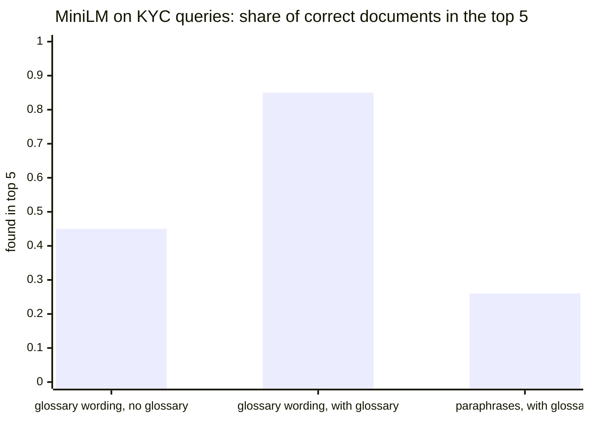
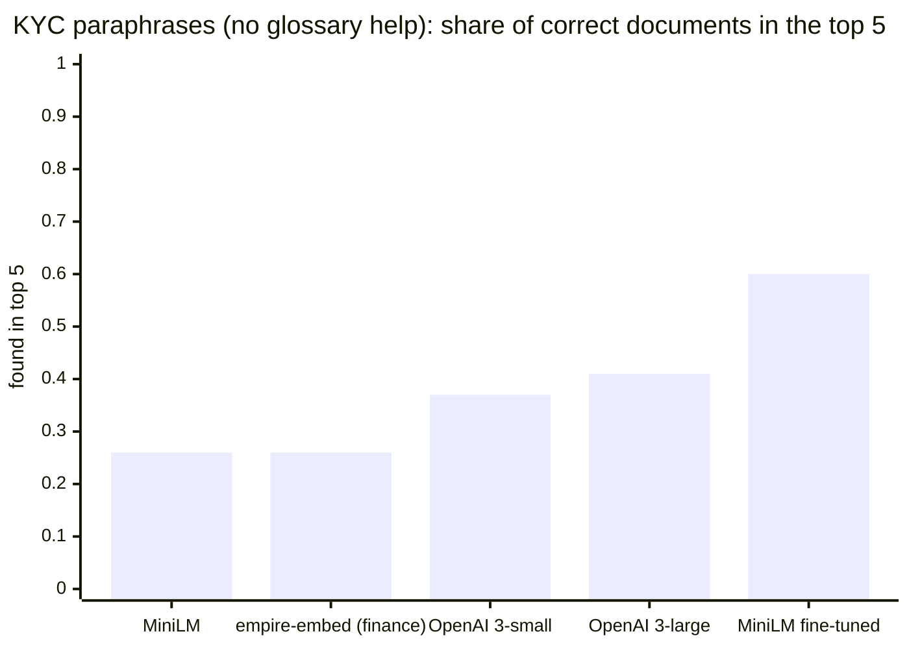

# Nevis Search API

Search API for a wealth-management firm: one `GET /search` across clients and their documents.
Clients are found by email, name or description, including partial words and typos
(`NevisWealth` -> `john.doe@neviswealth.com`); documents are found by meaning, with a
Sentence-BERT model fine-tuned on wealth-management text and a domain synonym glossary
(`address proof` -> a utility bill), plus exact terms such as an IBAN.

- **Live:** https://neviswealthhometask.online (Swagger UI at
  [`/docs`](https://neviswealthhometask.online/docs)); every endpoint except `/health` and the
  docs needs the `X-API-Key` header, the key is shared separately.
- **Stack:** Python 3.14, FastAPI, PostgreSQL 18 with pgvector and pg_trgm, SQLAlchemy +
  Alembic, Docker Compose, Traefik (HTTPS), GitHub Actions (tests, build, deploy).

## Quick start

```bash
cp .env.example .env
docker compose up --build
```

- API: http://localhost:8000
- Swagger UI: http://localhost:8000/docs

Set `OPENAI_API_KEY` in `.env` to get document summaries: without it the `worker` service exits
and summaries stay `pending`. Everything else works without it.

## Design notes

- **Document indexing is synchronous.** `POST /clients/{id}/documents` splits the content into
  overlapping chunks and embeds them before returning `201`, so the document is searchable
  immediately, which is what the API contract implies.
- **Document size is capped at 100,000 characters** (~15k words, ~120 chunks). The spec sets no
  limit, but because embeddings are computed inside the request on a small CPU-only server, an
  unbounded document could hold the CPU for a long time and stall every other request. At this
  size indexing takes a couple of seconds, which comfortably covers statements, contracts and
  bills. Larger documents get `422`.
- **Summaries are asynchronous.** A separate `worker` service (`python -m app.worker`) generates
  them with OpenAI `gpt-4.1-mini`, using Postgres as its job queue: a new document is stored with
  `summary_status = pending` in the same transaction, so no job is lost if a process crashes.
  The worker checks for pending documents every 2 seconds and takes one with
  `FOR UPDATE SKIP LOCKED`, so several workers can run side by side without doing the same
  document twice. An OpenAI error marks the summary `failed` with the error text (no retries).
  Read it with `GET /documents/{id}/summary`; search results include it too.
- **The same document cannot be uploaded twice for a client.** A SHA-256 hash of the content is
  unique per client; a re-upload (even under another title) gets `409` with the existing
  document's id.
- **Document content lives in Postgres.** The API accepts plain text, which Postgres stores
  efficiently (TOAST), and keeping it next to its chunks means a document, its embeddings and
  its summary job are written in a single transaction.

### What I would change for production

The choices above keep the assignment simple and match the given API contract. In a real
deployment I would:

- **Store documents in object storage (S3).** Originals (PDFs, scans) and their raw text go to
  S3; the database keeps only the object key and metadata, plus the extracted chunks and
  embeddings needed for search.
- **Index documents through a queue.** The upload endpoint would store the document and return
  `202 Accepted` with an indexing status; workers would fetch the content from S3, chunk and
  embed it in the background. This removes model latency from the request path and lifts the
  document size limit, since large files can be processed (and streamed) asynchronously.

## How search works

`GET /search?q=...` returns one list of clients and documents ranked by relevance. Four
retrievers run independently and are merged with Reciprocal Rank Fusion (RRF, `k = 60`), which
combines ranks instead of raw scores, so trigram similarity, cosine similarity and full-text rank
never have to be compared directly:

| retriever | what it catches | example |
|---|---|---|
| clients: substring + trigram (`pg_trgm`) on email, full name, description | names, email domains, typos | `NevisWealth` -> `john.doe@neviswealth.com`, `neviswelth` |
| clients: Sentence-BERT on description | meaning of the description | |
| documents: Sentence-BERT on chunks | meaning, paraphrases | `investment strategy` -> "Portfolio review" |
| documents: Postgres full-text on chunks | exact terms embeddings miss | an IBAN or account number |

Before that, the query is expanded with domain synonyms from the `search_synonyms` table
(see below). Semantic matches below a cosine similarity of `0.30` are dropped, so an unrelated
query such as `weather forecast` returns an empty list instead of "the least bad" documents.

## Search quality: the embedding trade-off

The assignment's example, `address proof` -> a document containing `utility bill`, needs domain
knowledge: in KYC a utility bill *is* a proof of address, but the two phrases share no words and
a general-purpose model does not know they mean the same thing. Getting this right took several
attempts.

### How I measured

The test set was generated with an AI assistant (an LLM): a small set of the kind of content a
wealth advisor searches, 42 documents (KYC, income and source of funds, tax, investments,
pensions, estate planning, insurance, plus a few unrelated ones), written the way real documents
read, so a utility bill never says "proof of address". For 38 queries it lists which documents
are the correct answers. The queries come in three groups:

- **Glossary wording** (7 queries): KYC concepts phrased the way the synonym glossary phrases
  them, e.g. `address proof`, `photo id`.
- **Paraphrases** (8 queries): the *same* KYC concepts in other words, e.g. `evidence of
  residence`, `where does the client's money come from`. The glossary cannot help here, so this
  group shows whether the model itself understands the concept. It keeps the test honest: the
  first group uses the glossary's own wording, so it flatters the glossary.
- **General finance** (23 queries): topics the glossary does not cover, e.g. `pension`,
  `estate planning`.

Plus 5 "noise" queries (e.g. `weather forecast`) that should return nothing.

Two numbers are reported, both from 0 to 1, higher is better:

- **Found in top 5**: of the correct documents for a query, what share appears among the first 5
  results; averaged over the queries of a group. 0.85 means that, typically, 85% of what the
  advisor is looking for is on the first screen.
- **Filter quality (F1)**: the API does not just rank, it also drops results below a similarity
  threshold, so that `weather forecast` returns an empty list. F1 measures how well one threshold
  separates correct results from wrong ones across all queries, noise included: it is high only
  if few wrong results get through *and* few correct ones get cut. The threshold that gives the
  best F1 is the one the API should use.

(I also computed two more ranking measures, MRR, "how high is the first correct result", and
nDCG, "how good is the order of the top 10". They tell the same story as "found in top 5", so they
are left out here.)

### Step 1: the plain Sentence-BERT model

I started with `sentence-transformers/all-MiniLM-L6-v2`: small (~90 MB), fast on the 2-vCPU,
CPU-only server, and a common default. On general finance it is good (0.92 found in top 5), but on
KYC concepts it is weak: 0.45 with the glossary wording and 0.26 on paraphrases, i.e. most of the
KYC documents an advisor asks for are not on the first screen.

### Step 2: a synonym glossary

A quick, explainable fix: a table of domain synonyms (`address proof` -> `utility bill`, `bank
statement`, ...). When a query contains a glossary term, the search also looks for its synonyms.
This lifts the glossary-wording group from 0.45 to 0.85 and does not change anything else.

But it only fires on the exact wording it contains: on paraphrases it does nothing (0.26 stays
0.26). An advisor typing `evidence of residence` instead of `proof of residence` gets no help.



### Step 3: a better ready-made model that fits the server

The server has 2 vCPUs, 3.8 GB RAM and no GPU, so the model has to be small. I looked for models
trained on financial text and tried, among others, `WealthFromAI/empire-embed` and
`philschmid/bge-base-financial-matryoshka`, as well as larger general models (`all-mpnet-base-v2`,
`bge`, `e5`, `gte`) and more finance models (`fin-mpnet-base`,
`finance-embeddings-investopedia`, `snowflake-arctic-embed-financial`, `modernbert-embed-finance`,
`finance-gemma-300m-emb`, ...). Some are slightly better on general finance (`empire-embed`: 0.95),
but none understands the KYC paraphrases any better than MiniLM (0.25-0.26), several are worse, and
the strongest need more RAM or a GPU than the server has. I found no public KYC/AML-specific
embedding model.

### Step 4: OpenAI embeddings

Next I tried a large hosted model, OpenAI `text-embedding-3-small` and `text-embedding-3-large`.
`3-large` is the best model on general finance (0.99) and the best ready-made model on paraphrases,
but still weak there (0.41). Its filter quality is not better (F1 0.61 with the glossary vs 0.63
for MiniLM), and it adds per-query latency, cost and an external dependency that sees client data.
Not worth it for this use case.

### Step 5: fine-tuning MiniLM on wealth-management data

Since no ready model knows KYC, I taught one: I fine-tuned `all-MiniLM-L6-v2` on synthetic
wealth-management documents and advisor-style queries (details in
[The fine-tuned model](#the-fine-tuned-model)). Same size and speed as the original, so it still
runs on the server. Paraphrases go from 0.26 to 0.60, ahead of OpenAI `3-large`; general finance
improves slightly (0.92 -> 0.94), so nothing was forgotten. Together with the glossary it has the
best filter quality of all setups (F1 0.64). **This is what the API uses.**



### Results

The five best setups (numbers are "found in top 5"; filter quality is F1 at the best threshold):

| setup | glossary wording | paraphrases | general finance | filter quality (F1) @ threshold |
|---|---|---|---|---|
| **MiniLM fine-tuned + glossary** *(used)* | **0.85** | **0.60** | 0.94 | **0.64** @ 0.31 |
| MiniLM fine-tuned, no glossary | 0.59 | **0.60** | 0.94 | 0.53 @ 0.24 |
| MiniLM + glossary | 0.85 | 0.26 | 0.92 | 0.63 @ 0.35 |
| `empire-embed` + glossary | 0.85 | 0.26 | 0.95 | 0.63 @ 0.43 |
| OpenAI `text-embedding-3-large` + glossary | 0.85 | 0.41 | **0.99** | 0.61 @ 0.36 |

Also measured, and behind these: `bge-base-financial-matryoshka` (F1 0.55 with the glossary),
OpenAI `text-embedding-3-small` (0.58), and every model without the glossary (0.40-0.53).

What I take from it:

- **Model and glossary complement each other.** The fine-tuned model handles new wordings; the
  glossary gives instant, explainable fixes for known terms (one `INSERT`, no deploy).
- **Bigger or hosted is not automatically better.** OpenAI ranks general finance best, but the
  real gap was domain knowledge, and a small model trained on the domain closed more of it.
- **The threshold follows the model.** The fine-tuned model's similarities are lower overall, so
  the API keeps results above 0.30 (the F1-optimal value on this test set is 0.31).
- **Caveats.** The documents, queries and answers are AI-generated and few, so differences of a
  few points are noise. A real evaluation needs real, anonymised advisor queries, labelled by
  people who know the domain. Prod check: `evidence of residence` still finds nothing on the
  three-document demo data, so paraphrases are better, not solved.

### The synonym glossary

The glossary lives in the database (`search_synonyms`: `term -> synonym`, lowercase), seeded
with KYC / wealth-management concepts by migration `0002`, and can be extended without a deploy:

```sql
INSERT INTO search_synonyms (term, synonym) VALUES ('proof of address', 'electricity bill');
```

#### Known limitation: the glossary does not scale for free

Every synonym that fires becomes one more vector, and every vector is one more embedding and one
more vector-index query per semantic retriever (clients and documents). The cost depends on how
many synonyms a query hits, not on the glossary's size: `investment strategy` costs 1 vector,
`address proof` 6, `proof of address and source of funds` 10. A glossary that grows in breadth
is fine; one where terms collect dozens of synonyms, or long queries hit many terms, makes each
search proportionally slower.

I did not find a good solution that keeps both quality and the vector index:

- capping the number of synonyms per query bounds the cost, but drops synonyms arbitrarily;
- ranking by the nearest of all vectors (`least(...)`) in a single query cannot use the HNSW
  index and scans the whole table.

In practice this may never matter: the glossary is likely to stay small (a curated list of
domain concepts, not a thesaurus), and it may not be needed at all with a model trained on the
firm's own data, which learns these equivalences instead of looking them up (see the
fine-tuned model below, which already closes much of the gap without the glossary).

### The fine-tuned model

[`UmbrellaMalware/all-MiniLM-L6-v2-wealth`](https://huggingface.co/UmbrellaMalware/all-MiniLM-L6-v2-wealth)
is `all-MiniLM-L6-v2` fine-tuned on **synthetic** data: an LLM
(`gpt-4.1-mini`) wrote 264 realistic documents across 44 wealth-management categories and 1,584
adviser-style queries for them. It never saw the benchmark documents or queries, and generated
queries close to benchmark ones were filtered out. Training takes ~8 seconds on a laptop GPU;
three training runs gave 0.58-0.60 on paraphrases. The model card on Hugging Face documents
data, training and limitations.

Honest limits: the training documents are LLM-generated and cover the same categories as the
benchmark, so the gain on real documents is probably smaller; it should be validated (and the
model re-trained) on real, anonymised advisor queries. Changing the embedding model requires
re-embedding stored documents (the vectors of different models are not comparable).

**For Nevis specifically**, advisors search mostly financial content (portfolios, statements,
tax, investment proposals), with KYC/onboarding documents as one important slice. So the model I
would aim for is a finance-tuned base fine-tuned further on KYC pairs: start from a financial
embedding model (in my runs `WealthFromAI/empire-embed`, a finance-tuned MiniLM, did best, but
its licence would need clarifying first; `philschmid/bge-base-financial-matryoshka` is a
documented alternative) and fine-tune
it on labelled advisor queries and documents that cover both the financial and the KYC
vocabulary, so it learns "address proof -> utility bill" without forgetting the financial domain
(mixing the two kinds of pairs in training avoids that). Until such labelled data exists, the
glossary is the safe, explainable bridge, and it stays useful afterwards for brand-new terms.

With more resources or budget, I would prefer exactly that: a finance model fine-tuned further on
KYC data, trained on real, labelled advisor queries instead of synthetic ones, on a server with
enough memory (or a GPU) for a larger base model.

## Tests

```bash
docker compose --profile test run --rm tests
```
